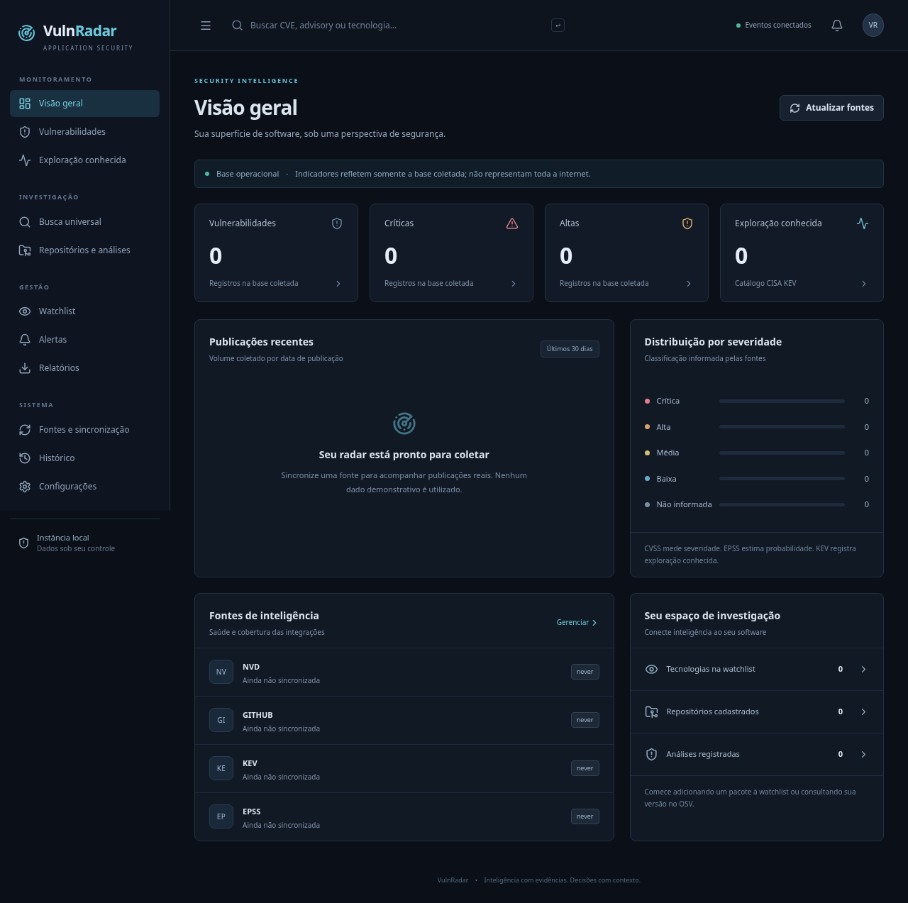

# VulnRadar

Plataforma local de Application Security e inteligência de vulnerabilidades, em desenvolvimento. Backend FastAPI/SQLAlchemy, frontend React/TypeScript/Vite e SQLite com migrações Alembic. Licença escolhida: MIT.

**A especificação completa ainda não está concluída.** Consulte [estado da implementação](docs/IMPLEMENTATION_STATUS.md) para cobertura, validações e pendências. Não há dados demonstrativos no banco operacional.



## Funcionalidades presentes

- Dashboard com contadores, severidades, gráfico das publicações coletadas e estado das fontes.
- Feed paginado, pesquisa por texto/identificadores/aliases/pacotes, filtros avançados por fonte, ecossistema, CVSS, EPSS, data, triagem e listagem KEV.
- Conectores NVD, GitHub Advisory, CISA KEV e FIRST EPSS; OSV por pacote/versão. As cinco fontes passaram na suíte de integração real; o KEV usa o espelho oficial CISA no GitHub quando o site principal falha.
- Evidências originais por fonte; deduplicação por aliases explícitos, sem unir registros por título.
- Busca OSV por pacote e versão, com erros de consulta incompleta visíveis.
- Watchlist persistente, verificação manual por versão e alertas locais deduplicados; checagem recorrente quando coleta automática estiver habilitada.
- Cadastro de repositórios dentro de raízes autorizadas, jobs de scan, histórico e resultados persistidos.
- SCA com package-lock, Yarn v1/estrutura moderna básica, pnpm v6/v9 básico, requirements com pins, Poetry, Pipfile, Cargo, Composer, go.mod, POM básico, Gradle lock e NuGet lock; CycloneDX JSON com PURLs suportados.
- Semgrep com seis regras locais iniciais; snapshot limitado, sem executar código do alvo e sem enviar seu conteúdo a serviços externos.
- Detalhamento com pacotes afetados, correções e referências por fonte, além de dados originais; triagem com justificativa e histórico; priorização explicável preliminar.
- Eventos SSE, central de alertas e histórico operacional.
- CSV/JSON de vulnerabilidades, JSON de scans, SARIF SAST e CycloneDX do inventário SCA.

Não há comprovação automática de alcançabilidade ou explorabilidade. Ausência de resultados não comprova segurança. As seis regras SAST não cobrem todas as categorias da especificação.

## Requisitos

Python 3.12, Node.js 24 e npm. Chromium para testes de navegação. Semgrep é instalado separadamente para evitar conflitos de dependências com o backend.

### Linux

Na raiz do checkout:

```bash
bash scripts/install.sh
python3 -m venv .semgrep-venv
.semgrep-venv/bin/python -m pip install 'semgrep==1.184.0'
bash scripts/start.sh
```

A aplicação atende localmente em `127.0.0.1:8000`. O backend serve os arquivos compilados do frontend. Para desenvolvimento do frontend: `npm --prefix frontend run dev`, usando o proxy Vite para o backend.

### Windows 10/11

No PowerShell, na raiz do checkout:

```powershell
.\scripts\install.ps1
.\scripts\start.ps1 -OpenBrowser
```

Scripts e workflow Windows foram preparados, mas **não executados neste ambiente Linux**. A compatibilidade do Semgrep nativo com Windows não foi validada; use uma instalação Linux/WSL para o SAST até validação específica. Não considere esse recurso pronto no executável Windows.

O launcher PyInstaller utiliza `%LOCALAPPDATA%\VulnRadar` para o banco persistente. A execução pelos scripts usa `data/` na raiz do checkout por padrão.

## Configuração

Copie `.env.example` para `.env` na raiz, se necessário. As variáveis começam com `VULNRADAR_`:

| Variável | Uso |
| --- | --- |
| `DATABASE_URL` | SQLite local; SQLAlchemy aceita PostgreSQL com driver instalado separadamente, ainda não validado |
| `ALLOWED_ROOTS` | Lista JSON de raízes de scan autorizadas; padrão `[]` |
| `AUTO_SYNC` | `true` habilita coleta recorrente; inicialmente `false` para iniciar sem chamadas externas |
| `SYNC_MINUTES` | Intervalo de coleta, padrão 60 minutos, mínimo efetivo 5 |
| `NVD_API_KEY` | Chave NVD opcional |
| `GITHUB_TOKEN` | Token opcional para limites autenticados de advisories |
| `MAX_FILES` | Limite de arquivos por árvore, padrão 2000 |
| `MAX_FILE_BYTES` | Limite de cada arquivo, padrão 5 MB |
| `SCAN_TIMEOUT` | Prazo de scan em segundos, padrão 120 |

Exemplo de raiz Linux: `VULNRADAR_ALLOWED_ROOTS=["/caminho/projetos-autorizados"]`. No Windows use barras normais ou escape as barras no JSON. Reinicie o backend após alterações. Não use uma raiz que possa ser modificada por adversários simultaneamente.

Fontes necessárias: `services.nvd.nist.gov`, `api.github.com`, `api.osv.dev`, `www.cisa.gov`, `raw.githubusercontent.com` (espelho oficial CISA), `api.first.org`. Os nomes/versões das dependências são enviados ao OSV durante SCA e consulta de versões. Código-fonte não é enviado.

A coleta inicial NVD/GitHub cobre os últimos 7 dias; as seguintes usam checkpoints. KEV usa catálogo completo; EPSS enriquece somente CVEs já coletados. OSV não é apresentado como feed global.

## Testes

```bash
cd backend
../.venv/bin/pytest -q
cd ..
.venv/bin/ruff check backend
cd frontend
npm test
npm run build
# Com backend ativo e Chromium disponível:
CHROMIUM_PATH=/usr/bin/chromium npx playwright test
```

Os testes backend usam banco separado e respostas simuladas nas integrações; o teste Semgrep executa o binário real quando instalado. Os testes de navegação geram capturas reais em `docs/screenshots/`. A suíte de integração real é separada e opt-in: `VULNRADAR_LIVE_TESTS=1 ../.venv/bin/pytest tests/integration -q` em backend. Seus cinco testes ficam ignorados por padrão; a suíte foi executada no ambiente publicado e validou as cinco fontes, incluindo fallback para o espelho oficial KEV.

## Migrações e backup

```bash
.venv/bin/python -m alembic -c backend/alembic.ini upgrade head
.venv/bin/python scripts/backup.py data/vulnradar.db /caminho/backup-novo.db
```

O backup utiliza a API SQLite para preservar consistência com WAL. Restauração: pare o backend, preserve o banco atual, valide a integridade do backup e substitua o banco com o serviço parado; não misture arquivos WAL antigos com o banco restaurado. Não há restauração por upload web.

## Docker

```bash
docker compose up --build
```

Configuração preparada, **build Docker não validado nesta sessão**. O Compose publica somente em loopback e não monta repositórios do host. Para scans, adicione montagens somente leitura explícitas e raízes correspondentes. Semgrep não está incluído na imagem base. Não exponha esta aplicação diretamente na internet.

## Executável Windows

O workflow `.github/workflows/windows.yml` configura build e upload de artefato, sem publicar releases. Para gerar manualmente em Windows, após build frontend:

```powershell
.venv\Scripts\python.exe -m pip install pyinstaller
.venv\Scripts\pyinstaller.exe --noconfirm --name VulnRadar --onedir --paths backend --collect-submodules app --collect-submodules uvicorn --collect-submodules sqlalchemy --add-data "frontend/dist;frontend/dist" --add-data "backend/alembic;backend/alembic" --add-data "backend/alembic.ini;backend" --add-data "rules;rules" scripts/desktop.py
```

Não foi gerado nem testado um executável Windows nesta sessão.

## Segurança e publicação

Leia [SECURITY.md](SECURITY.md) e [arquitetura e limites](docs/ARCHITECTURE.md). A API local tem restrição de Host/CORS e cabeçalho explícito para mutações, sem autenticação multiusuário. Exposição remota exige autenticação, autorização, TLS e isolamento de scanners adicionais.

Para publicar no GitHub: revise `git status`, execute os testes, verifique que dados/credenciais/ambientes virtuais estão ignorados e faça commit/push somente com autorização do proprietário. A implementação é enviada em branch de feature para revisão por pull request; não há publicação automática de releases.

Outras capturas reais: [feed](docs/screenshots/feed.png), [busca](docs/screenshots/search.png), [watchlist](docs/screenshots/watchlist.png), [repositórios](docs/screenshots/projects.png).
