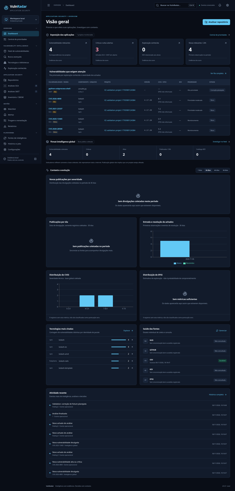

# VulnRadar

Plataforma local de Application Security e Vulnerability Intelligence. A V2 organiza investigação, exposição de aplicações e remediação com evidências de análises, preservando a distinção entre vulnerabilidades públicas e achados dos seus projetos.

**Uso local.** Não exponha a aplicação diretamente na internet. Autenticação multiusuário e isolamento remoto de scanners não estão implementados. [Limitações e estado da implementação](docs/IMPLEMENTATION_STATUS.md). Licença MIT.



## Fluxos disponíveis

- **Overview:** indicadores derivados de achados locais, fila operacional, inteligência global em seção separada, gráficos com períodos 7/30/60/90 dias, estado das fontes e atividade recente. Sem projetos/análises, mostra informação desconhecida em vez de substituir por CVEs globais.
- **Inteligência:** feed paginado, busca por aliases/pacotes, filtros combinados em drawer, chips, favoritos locais, colunas, densidade, seleção/exportação e ordenação no servidor. Detalhes em abas: resumo, componentes, exploração, projetos e histórico.
- **Busca universal:** Ctrl+K ou botão da topbar; resultados por vulnerabilidade, pacote e repositório. Consulta OSV por pacote com versão opcional.
- **Application Security:** seleção de pastas autorizadas, detecção de linguagens/lockfiles, escolha SCA/SAST/combinada, pré-requisitos, etapas reais, cancelamento, inventário e resultados por ferramenta.
- **Remediação:** achados normalizados por projeto, evidências preservadas por execução, filas de trabalho e justificativas. Análise parcial nunca resolve um achado apenas por ausência.
- **Monitoramento:** watchlist com severidade mínima, alertas opcionais e histórico, verificação manual ou agendada, coletas incrementais e SSE com reconexão.
- **Plataforma:** histórico de sincronizações, duração/paginação/novos/atualizados quando contabilizados, preferências persistentes, tema claro/escuro e agendamento editável.
- **Exportações:** CSV/JSON de vulnerabilidades; JSON, SARIF SAST e CycloneDX de inventário por scan. CSV protegido contra fórmulas.

## Requisitos e execução Linux

Python 3.12, Node.js 24, npm. Semgrep usa ambiente separado para evitar conflitos com as dependências do backend.

Na raiz do checkout:

```bash
bash scripts/install.sh
python3 -m venv .semgrep-venv
.semgrep-venv/bin/python -m pip install 'semgrep==1.184.0'
bash scripts/start.sh
```

Backend e frontend compilado atendem em `127.0.0.1:8000`. Para desenvolver o frontend, mantenha o backend ativo e execute `npm --prefix frontend run dev`.

### Autorizar diretórios

Copie `.env.example` para `.env` e informe somente pastas que você pretende analisar:

```dotenv
VULNRADAR_ALLOWED_ROOTS=["/caminho/dos/projetos"]
```

Reinicie o serviço. A seleção de pastas da UI navega exclusivamente dentro dessas raízes. O navegador não ganha acesso ao filesystem completo. Em containers, monte explicitamente os diretórios autorizados como somente leitura. Não analise árvores que adversários possam modificar simultaneamente.

## Windows 10/11

Com Python 3.12 e Node 24 instalados, execute na raiz pelo PowerShell:

```powershell
.\scripts\install.ps1
.\scripts\start.ps1 -OpenBrowser
```

Configure raízes no `.env` usando lista JSON e barras normais, por exemplo `VULNRADAR_ALLOWED_ROOTS=["C:/Projetos"]`.

O workflow Windows compilou a versão anterior no GitHub; isso não comprova execução interativa do aplicativo em Windows. O workflow da V2 fará uma nova compilação no PR. Semgrep nativo Windows não foi validado; SAST deve usar uma instalação compatível (por exemplo Linux/WSL). SCA permanece independente do Semgrep.

## Fontes e configuração

| Variável `VULNRADAR_…` | Uso |
| --- | --- |
| `DATABASE_URL` | SQLite padrão `sqlite:///./data/vulnradar.db`; PostgreSQL requer driver/configuração separados e validação |
| `ALLOWED_ROOTS` | Lista JSON de raízes autorizadas, padrão `[]` |
| `AUTO_SYNC`, `SYNC_MINUTES` | Valores iniciais do agendamento: desabilitado, 60 minutos; após configuração na UI, o banco guarda a preferência |
| `NVD_API_KEY`, `GITHUB_TOKEN` | Credenciais opcionais para limites maiores; nunca retornadas ao frontend |
| `MAX_FILES`, `MAX_FILE_BYTES` | 2000 arquivos e 5 MB por arquivo |
| `MAX_SCAN_BYTES` | 100 MB agregados por análise |
| `SCAN_TIMEOUT` | Prazo de análise, padrão 120 segundos |
| `WEBHOOK_URL` | Destino HTTPS opcional, configurado somente no servidor |
| `WEBHOOK_ALLOWED_HOSTS` | Lista JSON de hostnames explicitamente autorizados, obrigatória para webhook |
| `WEBHOOK_FORMAT` | `generic`, `slack` ou `teams` |
| `NOTIFICATION_INTERVAL_SECONDS` | Intervalo mínimo entre entregas; padrão 60 segundos |

Destinos de inteligência: `services.nvd.nist.gov`, `api.github.com`, `api.osv.dev`, `api.first.org`, `www.cisa.gov`, `raw.githubusercontent.com`. O KEV utiliza o espelho oficial `cisagov/kev-data` se o site CISA falhar. A carga inicial NVD/GitHub cobre os últimos 7 dias; coletas seguintes usam checkpoints. KEV usa catálogo completo; EPSS enriquece CVEs coletados; OSV é consulta por pacote, não um feed global.

SCA e watchlist enviam identidade e versão de pacotes ao OSV; código-fonte não é enviado. Semgrep usa regras locais, snapshot sem symlinks, argumentos sem shell, timeout e saída limitada. Trechos de evidência são preservados localmente com redação básica de padrões comuns de credenciais.

### Webhooks opcionais

Configure o destino e a allowlist no ambiente seguro do servidor; não os inclua no Git. Entregas têm histórico persistido, chave de idempotência, intervalo e até três tentativas com espera. Redirects e destinos privados são rejeitados. O payload exclui código, caminhos locais e campos arbitrários das ferramentas. Os formatos Slack/Teams usam mensagem textual simples e exigem um endpoint compatível.

Os testes usam transporte simulado; nenhuma notificação externa foi enviada nesta sessão. SMTP ainda não tem adaptador. Não há garantia de exactly-once: o receptor deve respeitar a chave de idempotência.

## Testes e evidência visual

```bash
cd backend
../.venv/bin/pytest -q
# Opcional, APIs públicas reais:
VULNRADAR_LIVE_TESTS=1 ../.venv/bin/pytest -q
cd ..
.venv/bin/ruff check backend
cd frontend
npm test
npm run build
```

Para navegador, use um **servidor descartável** em outro terminal; ele cria banco e repositório de fixture fora do checkout:

```bash
# Reproduzível, igual ao CI; OSV fictício isolado, Semgrep real:
.venv/bin/python scripts/start_test_server.py --mock-osv
# Depois, em frontend:
CHROMIUM_PATH=/usr/bin/chromium npx playwright test
```

Para testar OSV real, omita `--mock-osv`. Uma porta alternativa é aceita por `--port 8001`; defina `VULNRADAR_TEST_URL=http://127.0.0.1:8001` no comando Playwright correspondente. Use um servidor de teste novo quando quiser garantir estado inicial vazio.

A suíte cobre todas as 17 rotas em 1920, 1440, 1366, 1024, 768 e 390 px, teclado, drawers, filtros, favoritos, watchlist, análise combinada, triagem e exportação. Axe verifica automaticamente critérios WCAG A/AA selecionados. Isso não equivale a certificação ou auditoria humana completa de WCAG 2.2 AA.

[Galeria e contexto das capturas](docs/screenshots/v2/README.md). A galeria versionada foi capturada em instância de validação com fixture de repositório e respostas OSV reais; não é um banco de produção. O CI usa OSV fictício e identifica esse modo no log. Dados de teste nunca são inseridos pelo launcher operacional.

## Persistência, migrações e backup

Antes de iniciar uma versão nova:

```bash
.venv/bin/python scripts/backup.py data/vulnradar.db /caminho/backup-novo.db
.venv/bin/python -m alembic -c backend/alembic.ini upgrade head
```

A migração V2 é aditiva. Na inicialização, scans antigos são indexados de forma idempotente, preservando seu JSON e a triagem existente. Inventários e observações ficam por execução; achados são por projeto/motor/identidade. Resolução automática só ocorre com execução completa, mesmo motor e escopo comparável. Scans interrompidos ficam registrados como falha e podem ser reenviados; não são retomados automaticamente.

O backup utiliza `sqlite3.backup`, compatível com WAL. Para restaurar, pare o serviço, preserve o banco atual, valide o backup e substitua o banco sem reutilizar WALs antigos. Não há restauração por upload na UI.

## Docker e executável

```bash
docker compose up --build
```

Docker/Compose estão configurados, mas o build Docker não foi executado nesta sessão. O Compose publica somente em loopback e não monta projetos do host. Semgrep não está incluído na imagem padrão.

O workflow `.github/workflows/windows.yml` gera artefato PyInstaller, sem publicar releases. Para gerar manualmente em Windows após o build frontend:

```powershell
.venv\Scripts\python.exe -m pip install pyinstaller
.venv\Scripts\pyinstaller.exe --noconfirm --name VulnRadar --onedir --paths backend --collect-submodules app --collect-submodules uvicorn --collect-submodules sqlalchemy --add-data "frontend/dist;frontend/dist" --add-data "backend/alembic;backend/alembic" --add-data "backend/alembic.ini;backend" --add-data "rules;rules" scripts/desktop.py
```

O launcher empacotado usa `%LOCALAPPDATA%\VulnRadar` para o banco; os scripts de desenvolvimento usam `data/` no checkout. Não houve execução do binário Windows pelo agente.

## Arquitetura, segurança e limites

FastAPI, SQLAlchemy/Alembic, SQLite WAL, httpx, CVSS; React/TypeScript/Vite, Tailwind, TanStack Query, Recharts e componentes acessíveis próprios. Cada tarefa de nuvem usa o checkout existente; não crie worktree sem pedido explícito.

Leia [arquitetura](docs/ARCHITECTURE.md), [auditoria V2](docs/V2_AUDIT.md), [estado verificável](docs/IMPLEMENTATION_STATUS.md) e [segurança](SECURITY.md). A cobertura de CPE/runtimes, lockfiles, SAST, OCI e fontes externas está documentada na V3. A instalação é local por padrão. Ausência de correspondência não comprova segurança.

## Radar de publicações por período

A página inicial permite escolher **24h, 7 dias, 1 mês (30 dias), 3 meses (90 dias)** ou datas personalizadas e clicar em **Buscar vulnerabilidades**. O coletor consulta NVD e GitHub para a janela escolhida, mostra andamento e preserva os resultados. KEV/EPSS podem enriquecer o conjunto.

Críticas e altas aparecem primeiro; é possível pesquisar, filtrar, selecionar publicações para investigação e exportar o conjunto filtrado. A exposição dos seus repositórios continua separada em **Aplicações → Exposição das aplicações**.

[Fluxo, cobertura e validação do radar](docs/PUBLICATION_RADAR.md).

## Plataforma V3

[Implementação V3](docs/V3_STATUS.md) · [Critérios e testes](docs/V3_ACCEPTANCE.md) · [Auditoria](docs/V3_AUDIT.md)

Inclui oito jornadas de navegação, SCA/SAST/combinado, Trivy/Grype OCI opcionais, busca e monitoramento de produtos CPE/versões, remediação com responsável/SLA/validade e relatórios JSON/CSV/PDF. O histórico preserva estados passados e comparações identificam correções/recorrências. Migrações 0005/0006 são aditivas.

Para habilitar OCI após a instalação:

```bash
.venv/bin/python scripts/install_engines.py all
bash scripts/start.sh
```

O instalador verifica o SHA256 das releases oficiais. No Windows, use `.venv\Scripts\python.exe scripts/install_engines.py all` e `scripts/start.ps1`. Nenhuma imagem é executada; os scanners consultam o registro remoto e analisam suas camadas. Registros permitidos e timeout ficam em `.env.example`. Não é necessário Docker daemon.
