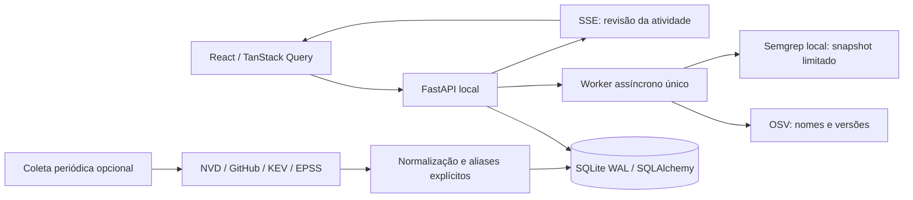

# Arquitetura e limites

## Módulos

- `backend/app/config.py`: configurações tipadas, sem retornar valores secretos à UI.
- `db.py`: modelos e fábrica de sessões; SQLite WAL, foreign keys e busy timeout.
- `schemas.py`: validação das entradas de API.
- `main.py`: ciclo de vida, controles HTTP e rotas.
- `workers.py`: tarefas de scan/sync, concorrência única e encerramento.
- `services/intelligence.py`: HTTP, backoff, normalização e coleta.
- `services/scanner.py`: parsers SCA e executor Semgrep.
- `services/monitoring.py`: correlação watchlist e classificação preliminar.
- `services/reporting.py`: conversão de inventário e achados.
- Frontend: layout em `main.tsx`, elementos compartilhados em `shared.tsx`, cliente API tipado e páginas separadas.

## Persistência

Vulnerabilities têm identificador canônico, severidade apresentada, CVSS/EPSS, KEV e triagem. Aliases são únicos e apontam para a vulnerabilidade. Advisories preservam JSON original por fonte/identificador. Um alias ponte pode consolidar registros existentes. A severidade apresentada corresponde à última normalização aplicada; divergências permanecem nas evidências originais, não são reconciliadas como uma verdade única.

AffectedPackages indexam identidades por ecossistema/pacote/advisory e preservam intervalos e correções da fonte. Sources mantêm último resultado, checkpoint e contagem. Activity registra eventos de coleta, triagem, alertas e EPSS. Watchlist armazena ecossistema/pacote/versão. Projects têm caminho autorizado. Scans persistem estado, resultado, inventário, achados e limitações em JSON. A modelagem de achados ainda não é normalizada em tabelas independentes.

Migração inicial congelada em Alembic; schema não é alterado implicitamente na inicialização. Jobs interrompidos são marcados como falha ao reiniciar, preservando histórico; não são retomados automaticamente. Instância única obrigatória: não inicie múltiplos workers Uvicorn sobre esse agendador.

## Contratos da API

`/docs` contém OpenAPI efetivo. Principais operações:

| Método / caminho | Contrato |
| --- | --- |
| GET /api/health | Testa acesso ao banco |
| GET /api/dashboard | Contadores e publicações coletadas |
| GET /api/vulnerabilities | q, severity, kev, triage, page, page_size, ecosystem, source, cvss_min, epss_min, published_after |
| GET /api/vulnerabilities/{id} | Evidências, aliases, histórico e priorização |
| PATCH /api/vulnerabilities/{id}/triage | status e reason obrigatórios |
| POST /api/search/package | ecosystem, package, version; erro 502 indica consulta incompleta |
| GET/POST /api/watchlist | Lista/cadastra item persistente |
| POST /api/watchlist/{id}/check | Consulta versão exata no OSV e deduplica alertas |
| DELETE /api/watchlist/{id} | Remove item |
| GET/POST /api/projects | Lista/cadastra caminho dentro de raiz autorizada |
| POST /api/projects/{id}/scans/{sca ou sast} | Enfileira scan persistente |
| GET /api/scans | Últimas 100 execuções |
| GET /api/scans/{id}/export | json, sarif ou cyclonedx, conforme tipo |
| GET /api/sources | Estado por fonte |
| POST /api/sources/{source}/sync | Dispara coleta em segundo plano |
| GET /api/activity | Últimos 100 eventos, kind opcional |
| GET /api/export | CSV ou JSON de até 50 mil vulnerabilidades |
| GET /api/settings | Configuração efetiva sem valores secretos |
| GET /api/events | SSE com revisão monotônica de atividade e heartbeat |

Mutações exigem `X-VulnRadar-Client: web` e, quando houver Origin, origem na lista permitida. CORS usa origens explícitas. Isto protege o caso local de requisições simples de sites externos; não substitui autenticação em implantação remota.

## Coleta e falhas

Requests têm timeout e até quatro tentativas para 429/5xx, com backoff/jitter. Retry-After numérico é limitado a 60 s. NVD/GitHub usam paginação; checkpoint só avança ao finalizar a fonte. Páginas já concluídas permanecem após erro posterior. Registro com zero resultados pode terminar em sucesso; é diferente de falha.

O agendador executa as fontes sequencialmente e depois verifica itens de watchlist com versão. A tarefa recorrente fica desabilitada por padrão até configuração explícita; intervalo padrão 60 min. Não há garantia de coleta instantânea, cobertura histórica completa ou disponibilidade externa.

## Priorização

Sem número de risco artificial: KEV → investigação imediata; EPSS >= 10% ou CVSS >= 9 → alta prioridade; CVSS >= 7 → moderada; dados menores → monitoramento; ausência de CVSS e EPSS → dados insuficientes. Exposição, criticidade do projeto e alcançabilidade ainda não entram no cálculo. EPSS não comprova exploração, e CVSS não é probabilidade.

## SCA/SAST

SCA extrai versões sem instalar pacotes; envia somente ecossistema/nome/versão ao OSV. Falhas viram cobertura parcial, nunca resultado limpo definitivo. POM não resolve herança/perfis/propriedades; versões flutuantes são reportadas como incompletas. go.mod não garante fechamento transitivo integral. Parsers Yarn/pnpm oferecem cobertura inicial, sem promessa de todos os formatos históricos. CycloneDX lê componentes com PURL suportado; não há upload dedicado na UI.

Semgrep usa snapshot temporário sem symlinks, regras locais e subprocesso sem shell. Seis regras iniciais não equivalem à cobertura de todas as vulnerabilidades ou categorias. Erros e ausência do binário fazem o scan falhar explicitamente. Findings são evidências para investigação, não exploração confirmada. Não há resolução automática por ausência em scan posterior.

## Threat model

Ativos: código confidencial, caminhos locais, banco e chaves externas. Fronteiras: navegador/API, filesystem/scanner e fontes externas. Ameaças: CSRF/DNS rebinding, XSS em advisory, traversal/symlinks, instalação de código malicioso, scanners sem limite e vazamento de secrets.

Controles presentes: bind loopback, Host permitido, Origin/CORS restritos, cabeçalho em mutações, React com escape padrão, CSP, SQL parametrizado, resolução de raízes, exclusão de symlinks, limites por arquivo/quantidade/timeout e um scan simultâneo. Credenciais não são retornadas pelo endpoint de configurações; erros externos persistidos omitem cabeçalhos e corpos.

Riscos residuais: alterações concorrentes na árvore de arquivos/junctions Windows, consumo agregado de memória do snapshot, usuário local malicioso com acesso ao processo, ausência de autenticação remota e sandbox forte de parser. Processos rodam com permissões do usuário. Scanners devem ser isolados antes de aceitar árvores adversariais em serviço remoto.

## Validação de distribuição

Linux local validado com testes e Chromium. Docker, PostgreSQL e PyInstaller Windows ainda não foram executados. CI/workflows são configuração proposta, não evidência de execução remota. Backup usa sqlite3.backup; restauração automática ainda não implementada.

## Evolução operacional V2

Migrações 0003 e 0004 adicionam:

- InventoryComponent: observação de componente por projeto/scan, versão, manifesto e estado da consulta.
- Finding: identidade por projeto/motor/fingerprint, vulnerabilidade opcional, severidade, arquivo/linha, correções e estado de remediação.
- FindingObservation: evidência de cada achado em uma execução; evita perder o histórico ao atualizar a última observação.
- PlatformSetting: preferências e agendamento validados. Raízes, credenciais e allowlists continuam configuração confiável do servidor.
- SyncRun: tentativa, duração, páginas e contagens por coleta. Valores OSV não contabilizados são apresentados como desconhecidos.
- NotificationDelivery: vínculo único ao alerta, tentativas, estados e próxima tentativa, sem armazenar URL/token.

O backfill inicial é idempotente e preserva o JSON de scans anteriores. Alias explícito pode consolidar vulnerabilidades e atualizar suas referências nos achados. A resolução por ausência exige motor e escopo comparáveis, análise completa e consultas concluídas. Falha parcial ou mudança desconhecida de regras não prova correção.

A API operacional fica em operations.py, com serviços de findings, projetos, monitoramento e notificações. APIs principais adicionais: `/api/exposure`, `/api/findings`, `/api/inventory`, `/api/technologies`, `/api/search/universal`, `/api/directories`, `/api/projects/{id}/inspect`, `/api/scans/{id}`, `/api/scans/{id}/cancel`, `/api/sync-runs`, `/api/preferences`, `/api/scheduler` e `/api/notification-deliveries`.

Filas de prioridade usam somente achados locais. O limiar EPSS persistido é aplicado de forma consistente à ordenação/listagem/detalhe. Severidade e métricas originais permanecem nas evidências. CVSS OSV é calculado a partir de vetor válido; vetor inválido continua desconhecido.

O frontend usa Tailwind, tokens CSS, consultas abortáveis e componentes próprios. Modal/Drawer usam dialog nativo para foco, Escape e fundo inerte; Tabs têm roving focus. Tabelas de achados/vulnerabilidades oferecem cartões em mobile. Rotas antigas continuam compatíveis.

Webhook: apenas destino HTTPS explícito no servidor, allowlist, rejeição de DNS/IP privado e de redirects, corpo com whitelist, timeout, intervalo e chave de idempotência. O DNS/egress do ambiente continua parte da fronteira de confiança. Nenhum dado de código/evidência é enviado no payload de notificação.
