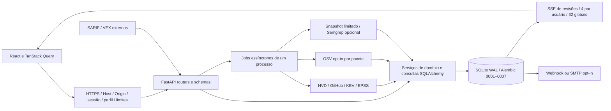
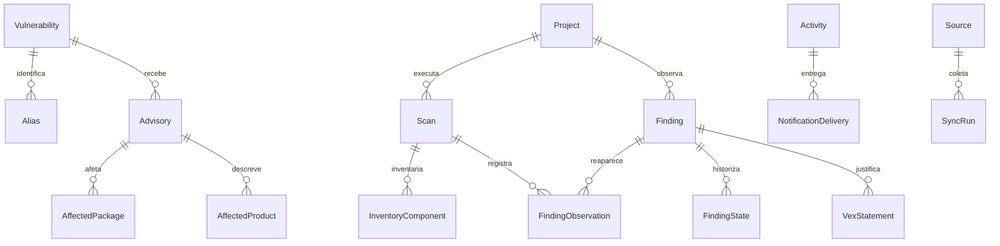
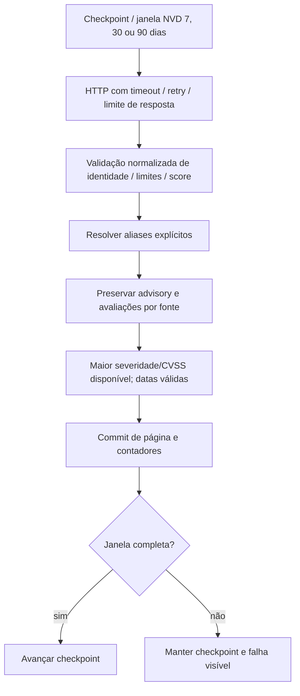
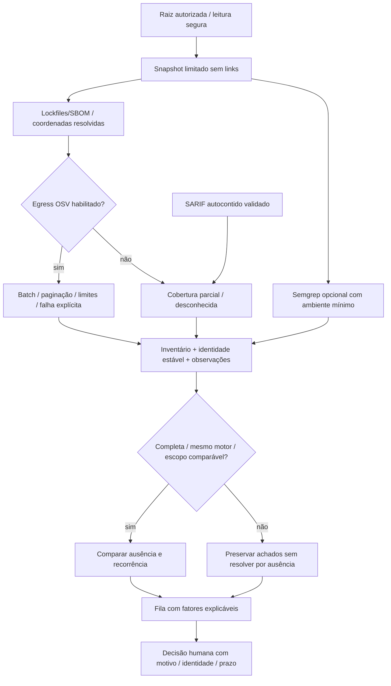

# Arquitetura V4

Suporte oficial: SQLite WAL, uma instância/worker, workspace de equipe compartilhado. PostgreSQL é experimental / NÃO VALIDADO, conforme [ADR 0001](adr/0001-banco.md). O objetivo é indexar e correlacionar vulnerabilidades de aplicações com evidência observada, mantendo inteligência pública separada de exposição local.

## Camadas reais e dívida

`access.py` e `http_security.py` centralizam a fronteira; `schemas.py` separa entradas/DTOs de Project e Scan; `imports.py` é um router fino para SARIF/VEX/retenção. Configuração tipada fica em `config.py`, sessões SQLAlchemy entram por `Depends(get_session)` e a identidade é propagada por ContextVar para auditoria transacional.

A arquitetura alvo é router → serviço → repositório → modelo. **A extração ainda é parcial:** `main.py`, `operations.py`, `services/products.py` e `reports.py` contêm consultas/regras em handlers, há retornos ORM legados sem DTO dedicado e não existe camada completa de repositórios. O inventário registra módulos grandes e funções acima de 60 linhas. Separar arquivos mecanicamente não foi usado como prova de redução dessa dívida. Strict do mypy cobre quatro módulos; os demais novos módulos ainda precisam de expansão gradual.

`services/oci.py` conserva normalizadores históricos e o POST 410; não executa Grype/Trivy. `scripts/install_engines.py` era um aviso sem instalação e foi removido. Módulos/documentos V2/V3 que ainda dão suporte a evidências, migrações ou testes não foram apagados por nomenclatura.

## Modelo de dados

Os nomes resumem relações conceituais; nem todas são FKs físicas (por exemplo `SyncRun.source`). O [schema real](review/v4/schema.sql) é a referência física. `Alias.id` é único; Finding usa `(project_id, kind, fingerprint)` e observação usa `(scan_id, finding_id)`. JSON preserva evidências, condições e avaliações originais. A V4 adiciona coluna consultável de exposição declarada, registros VEX e índices do feed sem reconstruir tabelas antigas. CHECKs de enums no banco legado continuam pendentes; entradas de domínio relevantes usam validação tipada.

Datas lidas/escritas no ORM são UTC explícito; datas antigas sem fuso são interpretadas como UTC. O timestamp representa publicação, coleta, descoberta ou mudança conforme o campo, sem intercambiá-los. Índices de severidade/publicação e KEV/publicação foram confirmados por EXPLAIN em banco descartável; [planos](review/v4/query-plans.json) não equivalem a benchmark com volume de produção.

Migrações 0001–0006 permanecem históricas. 0007 é aditiva, preservando inventários, observações, triagem e estados. O launcher oficial de migração faz backup SQLite consistente antes de atualizar banco existente com revisão diferente. Backfill é idempotente e não inventa histórico anterior. [Operação e restauração](RUNBOOK.md).

## Coleta e reconciliação

NVD/GitHub paginam e retomam a janela de forma idempotente; páginas já persistidas sobrevivem a falhas posteriores. NVD limita janelas atrasadas a 119 dias, espera 6,1 s sem chave e 0,7 s com chave. KEV tem fallback no espelho oficial e EPSS enriquece CVEs coletados; OSV é consulta por pacote, não um feed global.

Unificação depende de CVE/aliases explícitos, sem equivalência inventada por nome. A precedência de texto não vazio é NVD/GitHub/OSV; severidade/CVSS usam o maior valor disponível, preservando avaliações por fonte e divergências na investigação. Uma correção da fonte pode reduzir o resumo se nenhuma outra avaliação sustentar o valor antigo. Condições CPE sem interpretação segura ficam desconhecidas.

## Análise e decisões

SCA nunca instala dependências. A heurística de imports Python/JS/TS mostra observação e arquivos, sem provar reachability. Exposição à internet é declaração manual, inclusive desconhecida. KEV, EPSS, CVSS, import observado e exposição explicam a prioridade; ausência de import não reduz risco como prova negativa.

SAST usa regra, caminho relativo normalizado, digest e ordinal para estabilidade; cobertura/regras/motor/escopo precisam ser comparáveis para resolver por ausência. SARIF externo sempre entra parcial, com hash do artefato e resultados normalizados; não carrega arquivos/URIs externos. VEX limita-se a `not_affected` e versão/PURL exatos, com aplicação explícita auditada. [Perfil e limites](RUNBOOK.md).

## Jobs, observabilidade e UI

Fila de scans e sincronização têm locks separados e limites de backlog existentes. Cancelamento é persistido inclusive antes de obter slot; SAST encerra processo/grupo e aguarda saída. Reinício marca scans/fontes/sync-runs interrompidos como falha, preservando checkpoint e evidências, sem retomada automática nem resolução de achados. Supervisores reiniciam loops de agendamento/entrega após falhas com espera de 5 s. Não há coordenação distribuída ou garantia de execução exatamente uma vez.

SSE publica revisões para recarregar consultas, tem heartbeat/reconexão e orçamento por identidade/global. Logs estruturados incluem request-id e conta quando disponível, sem corpos/segredos; `/health` e `/ready` separam disponibilidade de prontidão de schema/chaves. O timeout HTTP limita a espera da resposta e não garante interromper CPU/trabalho síncrono já iniciado.

A UI tem tokens comuns, fila antes dos indicadores, inteligência global rotulada, tabelas densas, seleção/exportação, atalhos e drawers nativos com foco. As rotas antigas permanecem acessíveis; nem toda tabela legada foi reescrita para o componente Table. Testes de navegador/axe e capturas usam instância descartável; não substituem avaliação humana de acessibilidade. [Comparativo](screenshots/v4/README.md).
