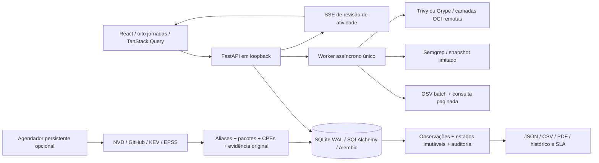

# Arquitetura — VulnRadar V3

## Fronteiras e execução

A instalação é local, com bind em 127.0.0.1, Host/Origin/CORS explícitos e cabeçalho de mutação. A API não implementa autenticação multiusuário; uso remoto requer autenticação, autorização, TLS e isolamento próprios. Uma instância/worker por banco; jobs interrompidos são marcados como falha reenviável.

Nenhum gerenciador de pacotes, build, instalador ou código de projeto é executado. SCA lê lockfiles/SBOMs; Semgrep analisa snapshot limitado. OCI lê camadas de registros autorizados usando CLIs opcionais e nunca inicia containers ou consulta Docker daemon. Scanners trabalham com as permissões do usuário local, não em sandbox forte.

## Persistência

- Vulnerability/Alias/Advisory: identidade canônica, aliases explícitos, payload por fonte, CVSS/EPSS/KEV e datas. A maior severidade informada nos advisories atuais é priorizada com o CVSS da própria avaliação. Mirrors sem nota não apagam avaliações conhecidas; divergências e payloads originais continuam visíveis.
- AffectedPackage: componente/ecossistema, intervalos e versões corrigidas. AffectedProduct: índice de CPEs NVD com fornecedor/produto e condições estruturadas. Nenhuma correspondência entre biblioteca e runtime é inferida por nome.
- Project/Scan: raiz autorizada, motor, estágio, estado, resultado e cobertura. InventoryComponent e FindingObservation preservam observações por execução. Finding mantém identidade estável e último estado operacional.
- FindingState: estado imutável por evento para exposição histórica, resolução e recorrência. O baseline registra o que se conhece na atualização; não inventa estados anteriores. Dias sem história/análise permanecem desconhecidos.
- Activity: auditoria, fonte, publicação/coleta/descoberta/atualização, triagem, alertas e falhas. Source/SyncRun: checkpoint, resultado, duração, paginação e contagens.
- Watch/ProductWatch: monitoramento específico por pacote ou fornecedor/produto/versão. PlatformSetting: preferências e agendamento. NotificationDelivery: tentativas e idempotência, sem armazenar secrets.

Migrações 0001–0006 são explícitas. 0005 adiciona owner/due_at/risk_expires_at/remediation_plan; 0006 adiciona produtos, monitoramento de produto e estados. Backfills são idempotentes e preservam JSON/triagem existente. Backup usa sqlite3.backup, compatível com WAL.

## Fluxos e cobertura

SCA normaliza nomes somente conforme equivalência do ecossistema, exige versão resolvida, deduplica queries e consulta OSV em lotes de 100. Resultados batch retornam IDs que são hidratados uma vez; consultas paginadas substituem batch ausente, incompleto ou com falha. Cache de sucesso TTL 5 min é limitado; erros não viram resultados limpos. HTTP aplica timeout e retry/backoff a rate limits/5xx.

SAST usa regra/arquivo/digest de código/ordinal da ocorrência para não criar achados por simples mudança de linha. Match legado é atualizado somente com evidência inequívoca. Regras, versão do mecanismo e escopo são comparados antes de resolver por ausência. Arquivos .semgrepignore/.gitignore não entram no snapshot e suppressões inline nosemgrep não desabilitam as regras da instalação; aplicabilidade é decidida por triagem auditável. SCA compara manifestos/consultas; OCI compara imagem e mecanismo. Análise parcial nunca resolve por ausência.

OCI normaliza relatórios preservando engine e payload original como evidência. Somente referências de registros autorizados são aceitas. Os processos não recebem shell, usam diretório/configuração temporários, timeout, limites de stdout/stderr, GOMAXPROCS=2 e orçamento Go de heap 512 MiB. Cancelamento mata/aguarda o subprocesso. A falta do binário gera pré-requisito explícito e não afeta os demais motores.

CPE usa igualdade/limites de versão verificáveis. AND/negação, update/plataforma específicos, curingas e ordenações não suportadas permanecem desconhecidos. Não são convertidos em prova de vulnerabilidade/explorabilidade. Produtos são verificados após coleta NVD e manualmente; alertas são deduplicados.

NVD/GitHub são paginados e incrementais; checkpoint avança ao completar a janela. NVD recupera instalações atrasadas em janelas de 119 dias. Páginas concluídas sobrevivem à falha de uma página posterior. KEV/EPSS preservam fonte e histórico. O agendamento é desabilitado por padrão até o usuário habilitar na UI.

Remediação exige justificativa. Aceite de risco requer validade futura, com datas normalizadas para UTC; expiração reabre automaticamente. Mudanças de dono/prazo/plano e estados são auditadas na mesma transação. Identidades resolvidas reaparecidas reabrem, preservando observações e decisões anteriores.

## API

OpenAPI efetivo: /docs. Grupos principais:

| Grupo | Endpoints |
| --- | --- |
| Inteligência | /api/vulnerabilities, /api/search/package, /api/search/universal, /api/products, /api/technologies |
| Monitoramento | /api/watchlist, /api/product-watches, /api/sources, /api/sync-runs, /api/scheduler |
| Projetos/análises | /api/projects, /api/directories, /api/projects/{id}/inspect, /api/projects/{id}/scans/{kind}, /api/projects/{id}/oci, /api/scans |
| Investigação | /api/findings, /api/findings/{id}/triage, /api/inventory, /api/exposure |
| Relatórios | /api/reports/findings (json/csv/pdf), /api/reports/exposure (json/csv/pdf), /api/scans/{id}/export (json/sarif/cyclonedx) |
| Operação | /api/health, /api/events, /api/activity, /api/preferences, /api/settings, /api/engines, /api/notification-deliveries |

Relatórios compartilham filtros entre tela e exportação. Série histórica aplica filtros ao estado registrado de cada dia, sem reclassificar o passado com a triagem atual. PDF servidor é A4 paginado e sem dependência externa; impressão do navegador também está disponível. JSON/CSV preservam Unicode completo. Truncamentos são explícitos.

## UI e segurança

React/TypeScript/Vite, Tailwind, tokens CSS, Recharts e componentes próprios. Oito jornadas com abas contextuais e URLs antigas preservadas com seus filtros. Consultas obsoletas são canceladas; modais/drawers usam dialog nativo, foco e Escape; tabelas têm paginação, filtros e ordenação conforme a jornada. Gráficos só aparecem com dados suficientes.

POSIX lê através de handles de cada diretório com O_NOFOLLOW; Windows verifica links/junctions e o destino final do handle. Arquivos não regulares e excessos são rejeitados. React escapa dados externos; links são limitados a HTTP(S), CSP/Host/Origin/CORS reduzem a superfície local. Logs omitem corpos/headers/secrets; snippets têm redação básica, sem promessa de DLP.

Webhook é opcional, HTTPS, allowlist explícita, recusa IP/DNS privados e redirects, payload restrito e idempotência. Egress/DNS continuam fronteira de confiança. Nenhuma mensagem real foi enviada pelo agente a um destino externo.

## Evidências e limites

Consulte V3_ACCEPTANCE.md e V3_STATUS.md. Testes usam bancos descartáveis e fixtures explicitamente separadas de integrações reais. Linux/Chromium e CLIs OCI foram exercitados; o workflow Windows executa testes e build PyInstaller. Build Windows não equivale a testar interação humana ou Semgrep nativo Windows. Docker/PostgreSQL não são requisitos do modo local e não foram executados nesta sessão.

Cobertura depende de regras, lockfiles, SBOMs e bases das fontes. Ausência de correspondência não comprova segurança. Implantação multiusuário, sandbox forte e certificação humana WCAG exigem processos específicos além desta aplicação local.

## Radar por período

A página inicial usa /api/radar para publicações/atualizações em janelas exatas de 24h, 7/30/90 dias ou intervalo personalizado. As contagens representam inteligência coletada e não substituem /api/exposure. O dashboard de aplicações permanece em /exposure. /api/radar/collect persiste a janela solicitada em RadarCollection (migração 0007); seus checkpoints são independentes da coleta incremental. Páginas concluídas sobrevivem a falhas/cancelamento. GitHub usa cursor after do Link, com detecção de repetição; timestamps são normalizados para segundos UTC aceitos pela API.
