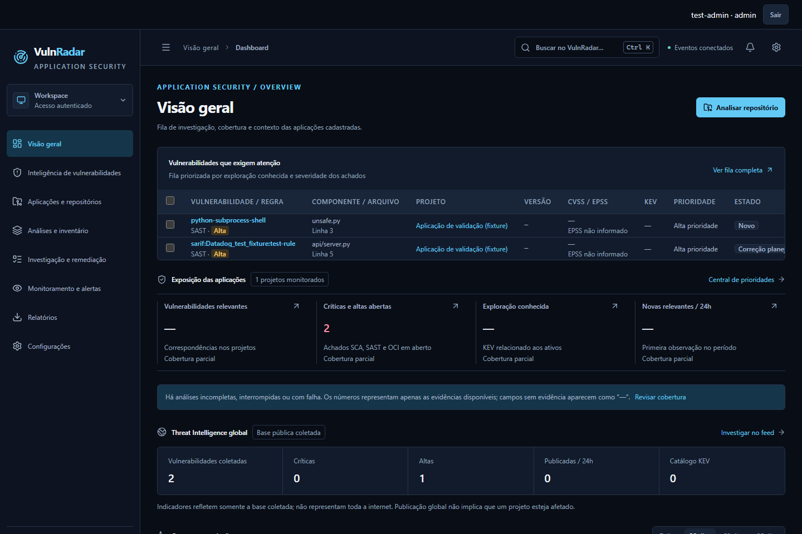
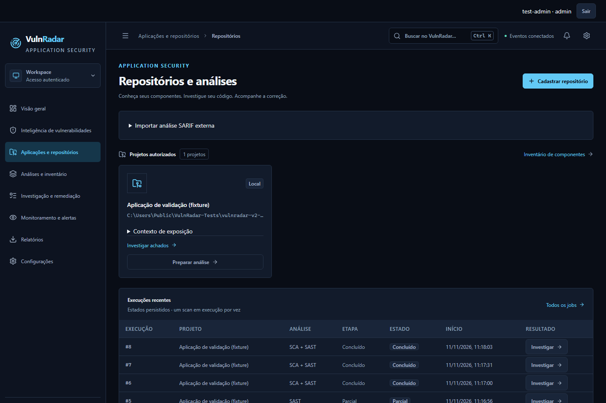
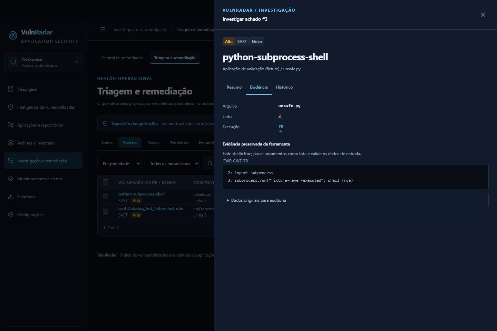
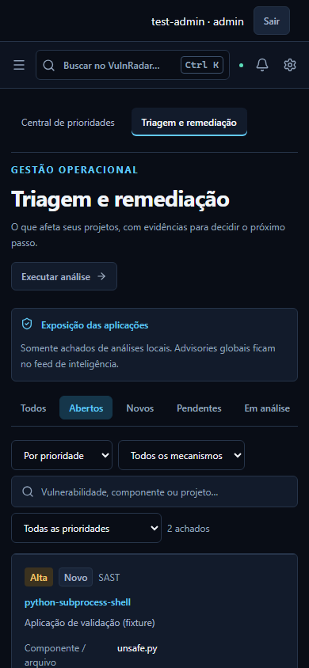

# Interface atual — 11/11/2026

Capturas reais de Chromium com a aplicação compilada, em banco e repositório descartáveis. O transporte OSV é fictício e identificado; SAST foi exercitado com Semgrep real pela suíte de navegador. O código do repositório de teste não é executado. Os valores exibidos não representam projetos de produção nem comprovam explorabilidade.

As imagens usam `C:/Users/Public/VulnRadar-Tests` como raiz temporária para não publicar o nome do usuário do Windows. Não há credenciais preenchidas, banco operacional ou dados de clientes. Os PNGs foram recapturados da aplicação, sem edição dos pixels ou geração artificial da interface.

## Desktop

[Tela de acesso com campo de chave vazio](1440/access.png) · [Fila de remediação](1440/remediation.png).

## Celular — 390 px

As capturas abaixo representam a área visível da tela, sem reduzir uma página inteira até tornar o texto ilegível.

[Visão geral no celular](390/overview.png) · [Aplicações no celular](390/projects.png).

## Reprodução e limites

Use `scripts/start_test_server.py --mock-osv`, com TEMP/TMP neutros no Windows, e execute os testes Playwright para preparar as evidências. Depois execute `node scripts/capture_docs.mjs` em `frontend`, com `VULNRADAR_TEST_URL` apontando para esse servidor e `VULNRADAR_SCREENSHOT_DIR=../docs/screenshots/readme`. O capturador exige o cabeçalho exclusivo da fixture descartável antes de autenticar ou cadastrar um projeto, e recusa raízes Windows de usuários pessoais.

O manifesto registra rotas, largura e estado capturado. As galerias [V2](../v2/README.md), [V3](../v3/README.md) e [comparação V4](../v4/README.md) têm contexto histórico próprio. A recaptura não remove imagens de commits antigos do Git; não foi reescrito o histórico.
