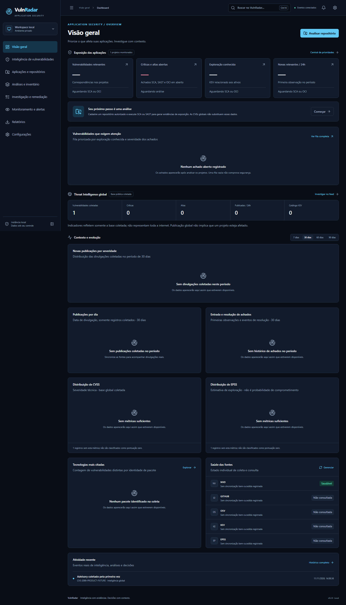
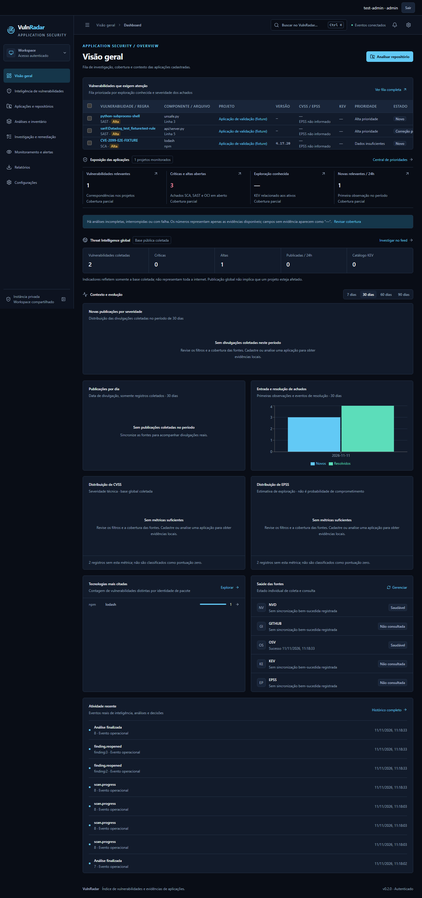

# Comparativo visual V4

Capturas reais do navegador sobre **banco e repositório descartáveis de teste**, com respostas OSV fictícias identificadas e Semgrep real. Não representam dados de produção ou um pentest do repositório de fixture. Antes e depois têm os mesmos 18 caminhos (17 jornadas/rotas históricas mais `/oci`) nas larguras 1920/1440/1366/1024/768/390 px. O estado evolui durante os testes, por isso as contagens não são comparáveis como métricas.

**Revisão de privacidade em 11/11/2026:** os dois conjuntos foram recapturados em caminhos neutros, substituindo imagens que expunham o usuário do Windows. O antes foi reconstruído a partir da fonte original `79eff96`, exportada somente para produzir artefatos, sem criar checkout/worktree; usa um novo banco de fixture e não reproduz as contagens do banco anterior. O depois corresponde à main revisada. Os arquivos antigos continuam em commits históricos; esta atualização não reescreve o Git. Para leitura rápida, use a [galeria atual do README](../readme/README.md).

| Superfície | Antes | Depois | Mudança observável |
| --- | --- | --- | --- |
| Overview 1440 | [Antes](before/1440/dashboard.png) | [Depois](after/1440/dashboard.png) | Fila primeiro, contexto em linha, sem quatro cartões idênticos no topo |
| Remediação 1440 | [Antes](before/1440/triage.png) | [Depois](after/1440/triage.png) | Tabela mais densa, seleção/exportação, identificação da sessão |
| Aplicações 1440 | [Antes](before/1440/projects.png) | [Depois](after/1440/projects.png) | Importação SARIF e exposição declarada |
| Feed 390 | [Antes](before/390/feed.png) | [Depois](after/390/feed.png) | Tokens comuns, estados neutros, navegação e drawer contidos na tela |
| Remediação 390 | [Antes](before/390/triage.png) | [Depois](after/390/triage.png) | Cartões móveis de leitura, motivos e acesso à investigação |
| Configurações 1440 | [Antes](before/1440/settings.png) | [Depois](after/1440/settings.png) | Política de privacidade/SAST e configuração conforme perfil |

Tokens ficam em `frontend/src/tokens.css`; cinco tamanhos, raios 2/4/6, uma família sans com fallback local e mono, neutros tintados, um acento e temas próprios. A fonte Public Sans não é baixada: a instalação usa fallback do sistema quando ela não existe. Sombras difusas e ícones decorativos de estados vazios foram removidos; status comuns são neutros e severidades mantêm rótulos. Tabelas principais têm j/k/Enter/Esc, cabeçalho fixo e drawers com foco.

A migração visual não é integral: componentes legados permanecem, nem toda tabela usa Table e há mensagens/nomes de eventos herdados a traduzir. Gráficos existentes ainda precisam de revisão editorial para reduzir painéis vazios e legendas redundantes. Axe passou nos critérios/fluxos automatizados; não há certificação WCAG nem comparação pixel a pixel. Reproduza com os comandos de [CONTRIBUTING](../../../CONTRIBUTING.md), usando sempre servidor descartável.
